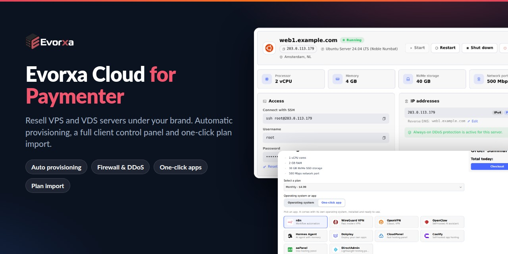
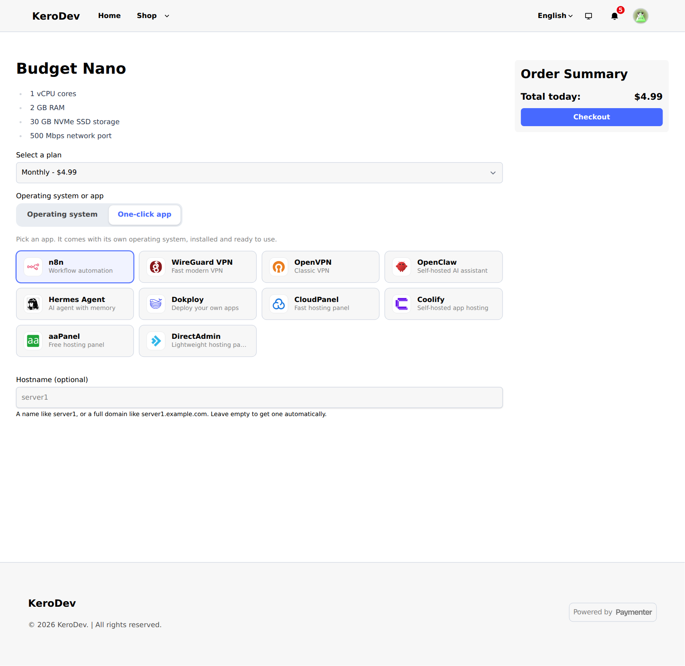
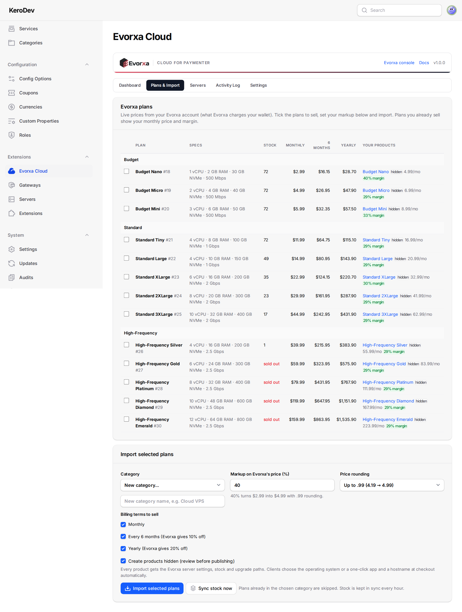
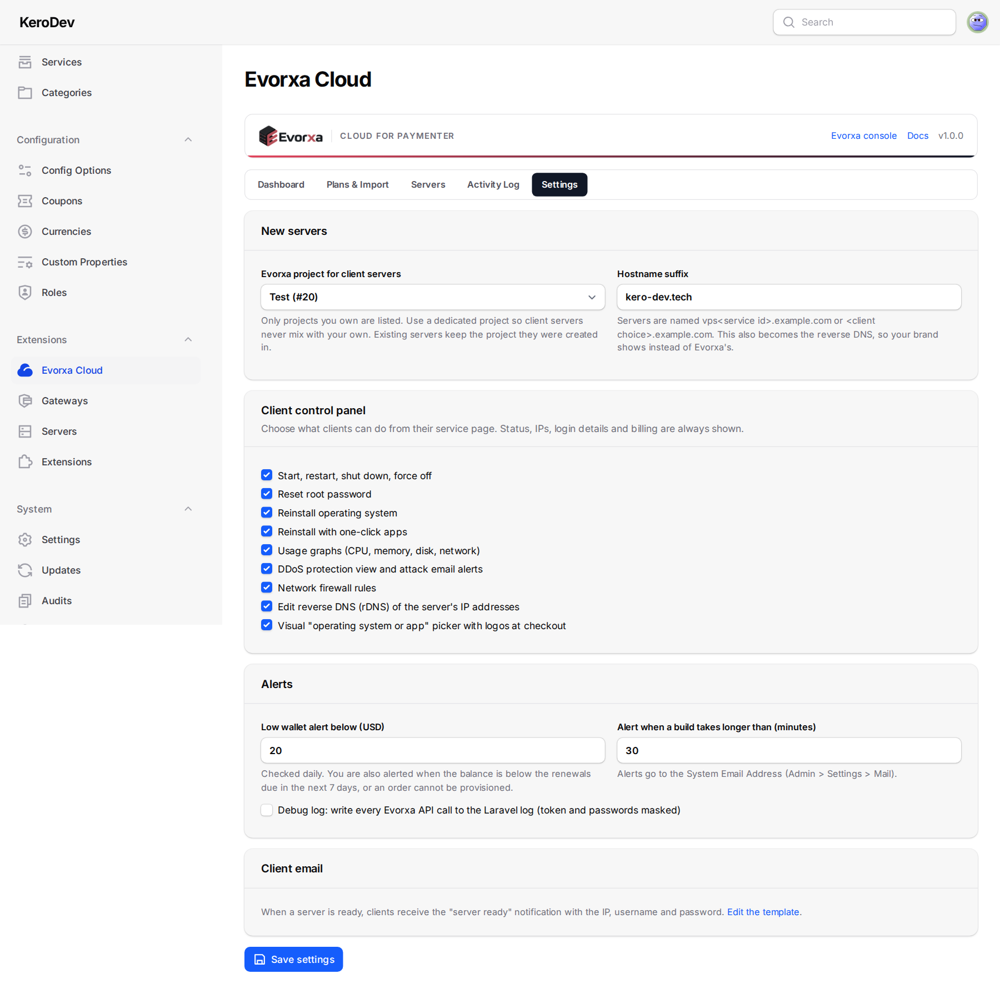

<p align="center">
  
</p>

<h1 align="center">Evorxa Cloud for Paymenter</h1>

<p align="center">
  <b>Resell Evorxa VPS and VDS cloud servers from Paymenter, under your own brand.</b><br>
  Automatic provisioning, a full client control panel, an OS or one-click app picker at checkout, and one-click plan import with your markup.
</p>

<p align="center">
  <a href="https://github.com/ScaleBit-Technologies/evorxa-paymenter/releases/latest"></a>
  
  
  
  <a href="LICENSE"></a>
  <a href="https://github.com/ScaleBit-Technologies/evorxa-paymenter/releases/latest/download/evorxa-paymenter.zip"></a>
</p>

<p align="center">
  <a href="#install">Install</a> ·
  <a href="#features">Features</a> ·
  <a href="#screenshots">Screenshots</a> ·
  <a href="docs/INSTALL.md">Installation guide</a> ·
  <a href="docs/USAGE.md">How to use</a> ·
  <a href="docs/CHANGELOG.md">Changelog</a>
</p>

---

**Evorxa Cloud** is a [Paymenter](https://paymenter.org) server extension for hosting companies that want to sell cloud servers without running their own hypervisors. Your client orders a VPS in your Paymenter store and picks an operating system or a one-click app. When the invoice is paid, the server is created on your [Evorxa](https://evorxa.com) account in about a minute. The client then gets a "server ready" email and a complete control panel on the service page. Suspensions, terminations with prorated refunds, upgrades and renewals are handled for you.

Looking for WHMCS? See **[evorxa-whmcs](https://github.com/ScaleBit-Technologies/evorxa-whmcs)**.

## Install

### Upload in Paymenter (no SSH)

1. Download **[evorxa-paymenter.zip](https://github.com/ScaleBit-Technologies/evorxa-paymenter/releases/latest/download/evorxa-paymenter.zip)**.
2. In Paymenter go to **Admin > Extensions**, click **Upload**, and choose the zip.

### One command (SSH)

```bash
curl -fsSL https://raw.githubusercontent.com/ScaleBit-Technologies/evorxa-paymenter/master/install.sh | bash -s -- /var/www/paymenter
```

Replace `/var/www/paymenter` with your Paymenter folder (the one that contains `artisan`). If `php` isn't the PHP that runs Paymenter, add `PHP_BIN=/usr/bin/php8.3` before `bash`. Run the same command again to **update**; the current copy is backed up to your home folder first. Restart the queue worker afterwards (`systemctl restart paymenter`).

### Then connect your Evorxa account (about 5 minutes)

1. **Evorxa console > API tokens**: create a token with `instances:read instances:write analytics:read shield:read shield:write wallet:read`.
2. **Admin > Servers > New server**: extension **Evorxa**, paste the token into **API token**, save, then **Test connection**.
3. **Admin > Evorxa Cloud > Settings**: choose the Evorxa project for client servers and your hostname suffix.
4. **Plans & Import**: tick the plans to sell, set your markup and import. Review the hidden products in **Admin > Products**, then unhide them.
5. Make sure the Paymenter cron (`schedule:run` every minute) and queue worker are running.

Step by step with screenshots: **[Installation guide](docs/INSTALL.md)**.

## Features

### A control panel your clients will love

A **Server** view on the service page, in Paymenter's theme colours (light and dark), English and Arabic, and fully white-label.

- **Power**: start, restart, shut down, force off
- **Access**: SSH command or RDP address, username, root password (hidden until *Show*) and **reset root password**
- **IP addresses** with **editable reverse DNS**
- **Usage graphs**: CPU, memory, disk and network
- **DDoS protection**: filtered vs clean traffic, attack history and email alerts
- **Network firewall**: on/off switch, default policies, quick-add rules and **drag-and-drop rule order**
- **Reinstall** with any operating system or a one-click app


### Operating system or one-click app at checkout

Logo cards on the checkout page instead of plain dropdowns: OS families with versions, or apps like n8n, Coolify, WireGuard, Nextcloud, cPanel, DirectAdmin or Pterodactyl. Your client can also pick a hostname.



### Evorxa Cloud admin page

- **Dashboard**: setup checklist, Evorxa wallet, next renewal, monthly revenue vs Evorxa cost and your margin, anything that needs attention
- **Plans & Import**: live Evorxa prices and stock; create Paymenter products with your markup and .99 rounding, in every currency, with upgrade paths
- **Servers**: reconcile Evorxa servers with Paymenter services; per-service power, password reset, sync, reactivate and "link existing server"
- **Activity log** of every action with the wallet charge or refund
- **Alerts** for low wallet, failed builds and servers suspended upstream (to your System Email Address)


### Safe with your money

- A server is **never bought twice**: the order is recorded before Evorxa is called, never retried blindly, and adopted by name if a request timed out.
- The extension **only touches servers it created**. Your own Evorxa projects are never listed or changed.
- **Terminate** deletes the server immediately, and Evorxa refunds the unused time to your wallet.
- **End-of-period cancellations** stop the Evorxa renewal in time.
- The **renewal keeper** reactivates a server Evorxa suspended while the client has paid.
- Free, one-time and hourly/daily/weekly plans are refused, because they would bill your wallet for time nobody pays for.

## Screenshots

| | |
|---|---|
|  |  |
|  |  |
|  |  |
|  |  |
|  |  |

## Requirements

| | |
|---|---|
| Paymenter | 1.x (developed and tested on 1.5.8) |
| PHP | 8.3 or newer with cURL (what Paymenter needs) |
| Cron + queue | `php artisan schedule:run` every minute and a running queue worker |
| Evorxa | an account with wallet balance and an API token |

## Documentation

- **[Installation guide](docs/INSTALL.md)**: upload or one-command install, connect Evorxa, import plans, update, uninstall
- **[How to use](docs/USAGE.md)**: daily operation, billing and renewals, the client panel, customising wording and colours, FAQ
- **[Changelog](docs/CHANGELOG.md)**

## Development

```
extension/Evorxa/     the extension (copied to extensions/Servers/Evorxa)
  Evorxa.php          Paymenter entry points
  Api/ Support/ Services/ Http/ Admin/   API client, provisioning, scheduler work, client API, admin page
  resources/          Blade views, CSS/JS, OS and app logos, English/Arabic strings
  database/           migrations (evorxa_services, evorxa_log, evorxa_settings)
install.sh            one-command installer / updater
bin/deploy.sh         copy into a Paymenter install: bin/deploy.sh /path/to/paymenter [owner:group]
bin/package.sh        build dist/evorxa-paymenter-<version>.zip (the uploadable package)
```

## Support

- Bugs and feature requests: [GitHub issues](https://github.com/ScaleBit-Technologies/evorxa-paymenter/issues)
- Evorxa account, API and billing: [evorxa.com](https://evorxa.com), support@evorxa.com

## License

[MIT](LICENSE) © 2026 ScaleBit Technologies, the company behind Evorxa.
