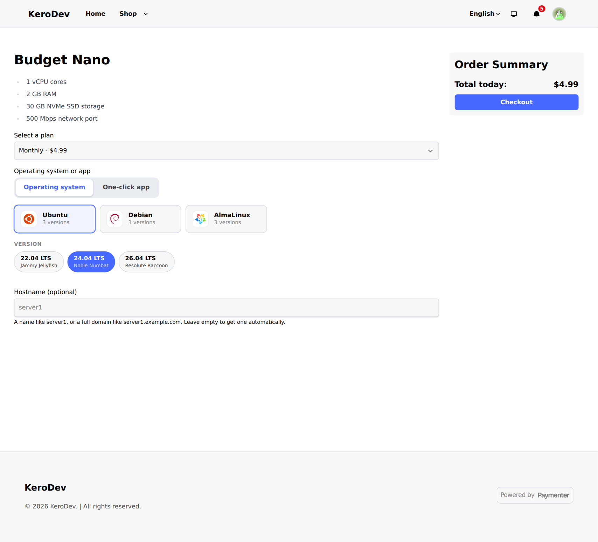
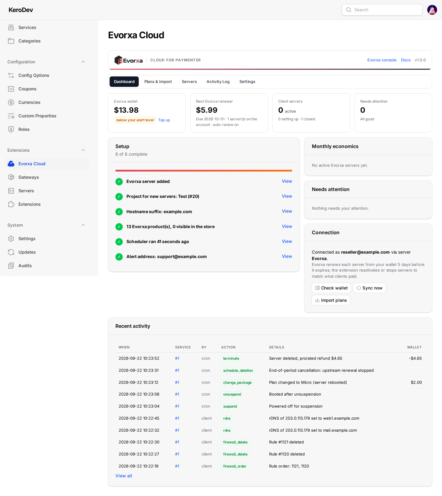
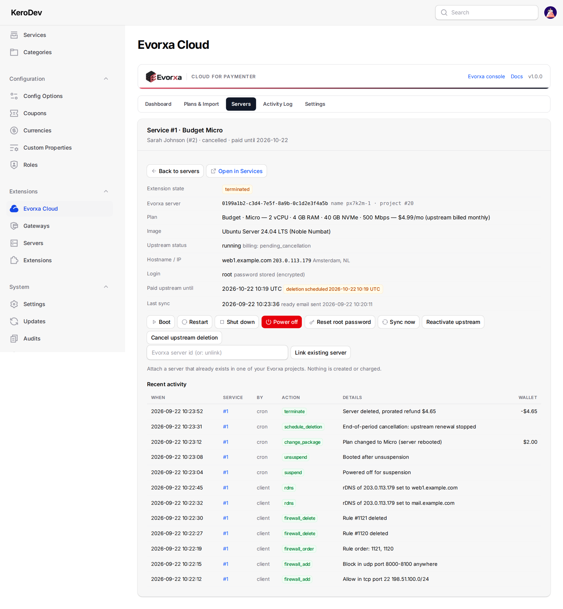
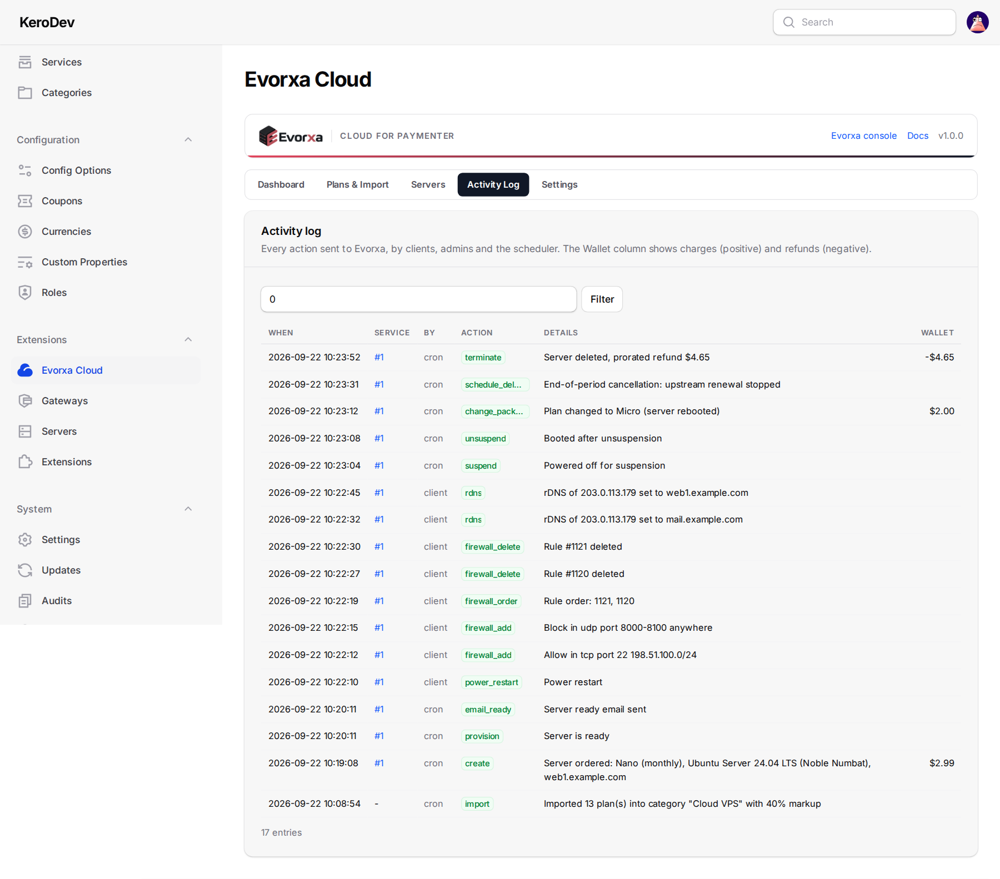
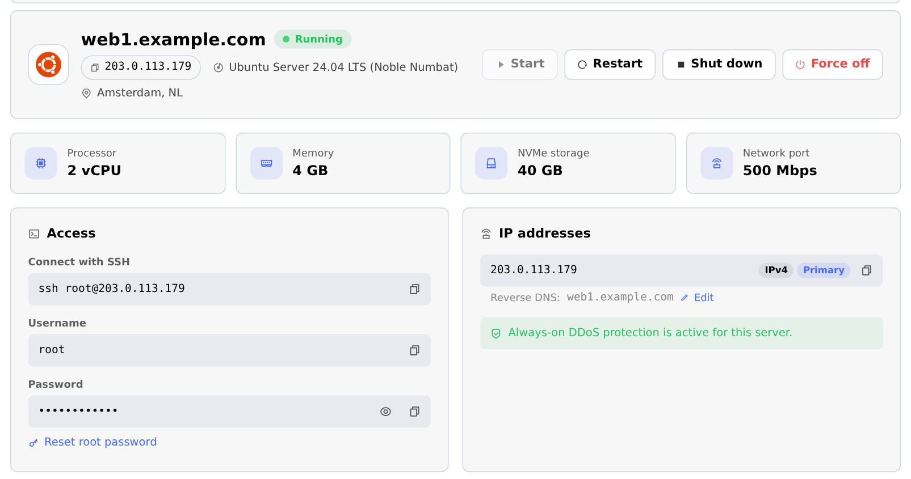
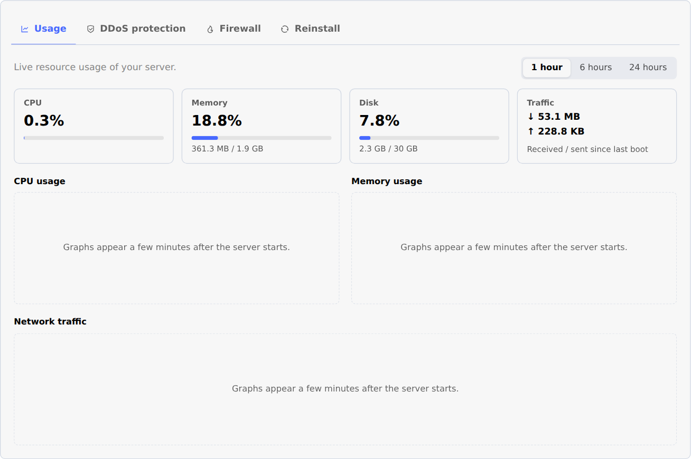
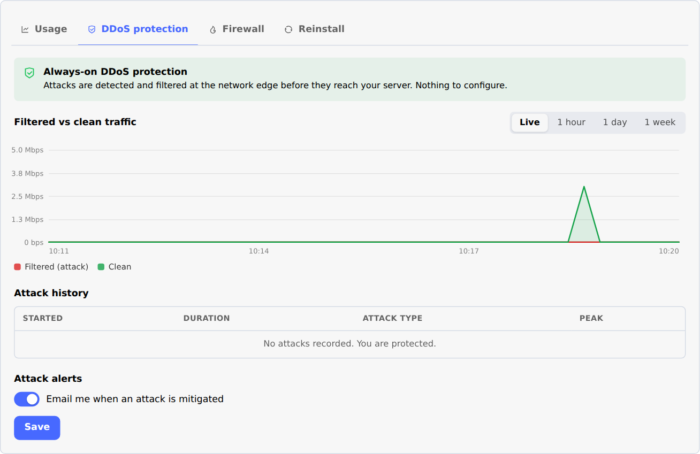
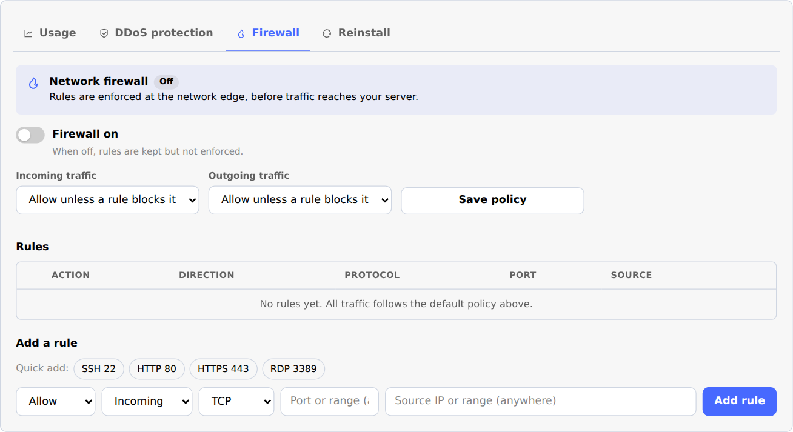

# How to use Evorxa Cloud for Paymenter

- [For admins](#for-admins) - selling, daily operation, billing, tools
- [For your clients](#for-your-clients) - the server control panel
- [Customising](#customising) - wording, languages, colours, logos, email
- [Troubleshooting & FAQ](#troubleshooting--faq)

---

## For admins

### How an order becomes a server

1. The client orders a product and picks an operating system **or** a one-click app, and optionally a hostname.

   

2. When the invoice is paid, Paymenter runs the create job: the extension checks stock and your wallet, then orders the server on Evorxa in your chosen project.
3. The client's service page shows the progress while the server is built (usually 1-5 minutes).
4. As soon as it is running, the IP, username and root password are stored (the password encrypted) and the client receives the **server ready** email.

### What happens on each Paymenter action

| Paymenter | On Evorxa |
|---|---|
| Invoice paid (new service) | Server ordered (paid from your wallet for one period) |
| Suspend | Server powered off |
| Unsuspend | Reactivated if Evorxa suspended it, pending deletion cancelled, powered on |
| Terminate | Server deleted immediately; Evorxa refunds the unused time to your wallet |
| Upgrade | Plan changed on Evorxa (the difference is prorated from your wallet), server rebooted |
| Renewal paid / cancellation requested | The renewal keeper checks the server right away |

### Billing and renewals

- **You pay Evorxa from your wallet; your clients pay you in Paymenter.** Evorxa renews each server from your wallet 5 days before it expires.
- The **renewal keeper** keeps both sides in line automatically:
  - a server Evorxa suspended (for example because the wallet was short) while the client has paid is **reactivated** and you get an alert;
  - an **end-of-period cancellation** stops the Evorxa renewal in time, so you don't pay for a period nobody uses;
  - a pending deletion on an active service is cancelled;
  - if you turned Evorxa auto-renew off, the server is extended only after the client has paid.
- Upstream billing term: by default the Evorxa term matches the client's plan (monthly, 6 months or yearly - the cheaper Evorxa prices). Per product you can choose *Always monthly upstream* in its server settings.
- Free, one-time and hour/day/week plans are refused (Evorxa would bill your wallet for time nobody pays for).
- **Keep your wallet topped up.** You get a daily email when the balance is below your alert level or below the renewals due in the next 7 days.

### The Evorxa Cloud admin page

- **Dashboard**: setup checklist, wallet, next renewal, monthly economics (what clients pay per month vs what Evorxa costs), anything that needs attention, recent activity, and *Check wallet* / *Sync now*.
- **Plans & Import**: live Evorxa prices and stock, your products with their monthly price and margin, and the importer. Stock is synced every hour, so sold-out plans cannot be ordered.
- **Servers**: every server in the projects this Paymenter uses, with its service. Flags unmanaged servers (billed but not linked), servers whose service is cancelled, and servers suspended upstream. Open a service to see its Evorxa details and use **Boot, Restart, Shut down, Power off, Reset root password, Sync now, Reactivate upstream, Cancel upstream deletion** and **Link existing server**.

  

- **Activity log**: every action sent to Evorxa - by clients, admins and the scheduler - with the result and the wallet charge or refund. Filter by service.

  

- **Settings**: project, hostname suffix, client features, alerts, debug log.

### Alerts

The System Email Address (Admin > Settings > Mail) is notified about: low wallet, a server that could not be created, a build that takes longer than your timeout, an ordered app that did not install, a server suspended upstream while the client is paid up, and servers missing upstream.

---

## For your clients

The service page gets a **Server** view (Paymenter's theme colours, light and dark, English and Arabic):

- **Power**: Start, Restart, Shut down, Force off (with confirmation).
- **Access**: SSH command (or RDP address for Windows), username, root password (hidden until *Show*), **Reset root password**.
- **IP addresses** with **reverse DNS** - click *Edit* to change it.
- **Usage** - CPU, memory, disk and network:

  

- **DDoS protection** - filtered vs clean traffic, attack history, email alerts:

  

- **Firewall** - on/off, default policy, rules (quick add for SSH/HTTP/HTTPS/RDP, port ranges, source IP or range) and **drag rules to change their order**:

  

- **Reinstall** - pick an operating system or a one-click app; a checkbox confirms that all data will be erased.

Paymenter shows the view for active services. Suspended and cancelled services show Paymenter's own status instead.

---

## Customising

- **Features** - switch any client feature, and the checkout picker, off in **Admin > Evorxa Cloud > Settings**.
- **Wording and languages** - English and Arabic are included (`resources/lang`). Put your own wording in `storage/app/evorxa/lang/<language>.php` (only the keys you change, same `$_LANG` format); it survives updates. Paymenter's `ar` locale uses the Arabic strings.
- **Colours** - the panel follows your Paymenter theme colours. Override any `--evx-*` CSS variable in your theme's CSS to fine-tune it.
- **Markup** - the client panel is `resources/views/panel.blade.php` + `partials/`. All data is in one `$evx` array, documented at the top of `panel.blade.php`; the script only relies on the `data-evx` / `data-action` / `data-power` hooks.
- **Logos** - operating system and app logos are in `resources/assets/logos/{os,apps}/<name>.svg|png`.
- **Email** - edit the **evorxa_server_ready** template in **Admin > Notifications**. Variables: `$hostname`, `$ip`, `$username`, `$password`, `$os`, `$is_windows`, `$location`, `$app_name`, `$app_url`, `$app_username`, `$app_password`, `$app_note`, `$app_missing`, `$panel_url`, `$service`.

---

## Troubleshooting & FAQ

**A paid order has no server / the service shows "setting up" for a long time.**
Open the service in **Admin > Evorxa Cloud > Servers**: the last error explains it (wallet too low, plan out of stock, no project chosen). Fix it and use Paymenter's *Create* action on the service. If the order timed out talking to Evorxa it shows as *unknown*: the extension checks every minute and adopts the server if it was created, so do not retry for 15 minutes.

**The client did not get the ready email.**
It is sent once the server is running (and its app is ready). Check *ready email sent* on the service detail, Paymenter's email log, and that the queue worker is running.

**A feature is missing for a client.**
Either it is switched off in Settings, or Evorxa locked it for that server.

**"The server panel is busy".**
Evorxa allows 60 API requests per minute per token. The panel caches data and backs off automatically; use a separate token for each billing installation.

**Can I use one Evorxa account for several Paymenter (or WHMCS) installs?**
Yes. Server names include a random per-install prefix, and each install only manages the servers it created. Use one project (and token) per install.

**What is never shown to clients?**
Your API token, Evorxa project and ids, your costs and Evorxa billing data, and upstream error messages. The root password is only shown when the client clicks *Show*.
